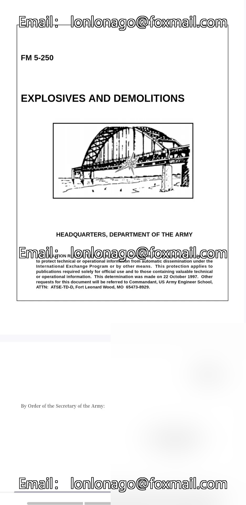
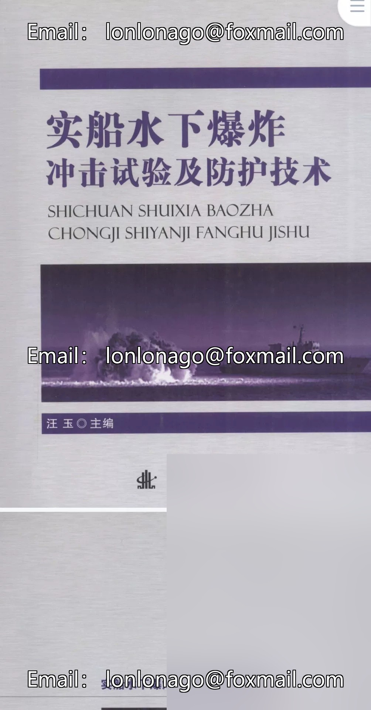
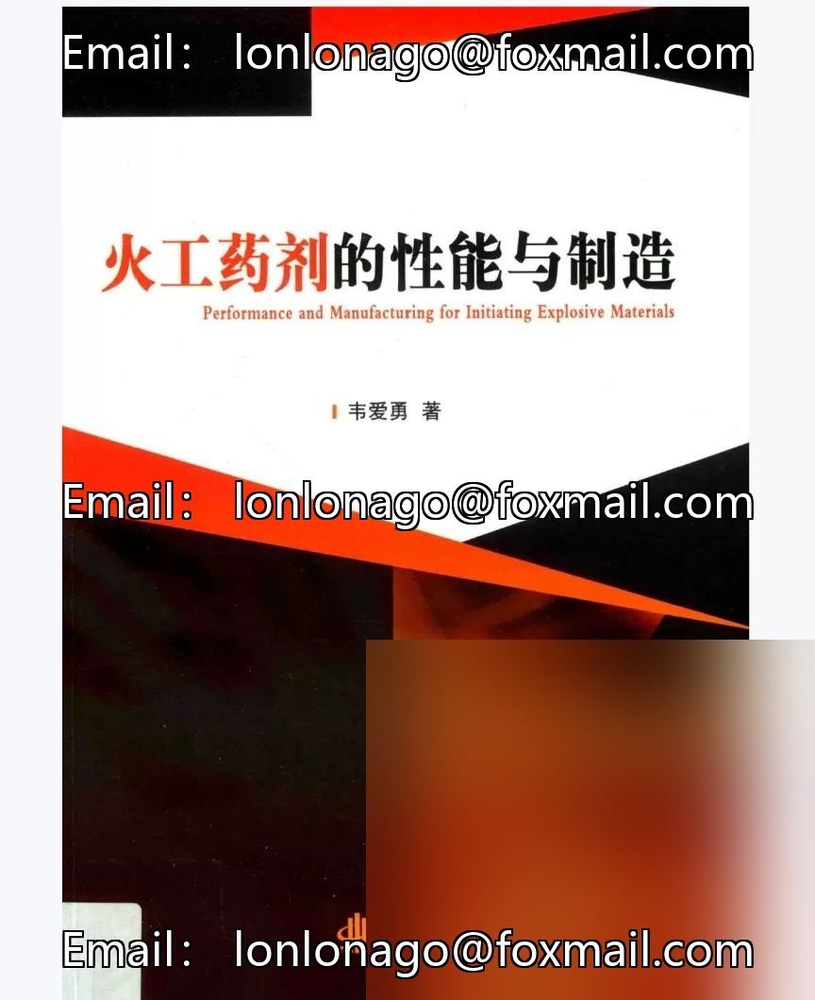
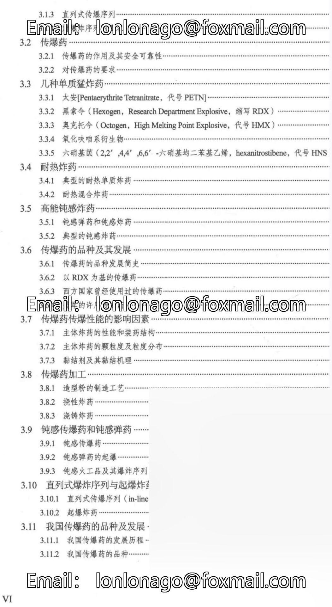

# 1.《FM 5-250: EXPLOSIVES AND DE

## Body

1.《FM 5-250: EXPLOSIVES AND DEMOLITIONS》, U.S. Army Department Explosive Technology Handbook, specifying explosive operation and demolition tactics.
2.《Actual Ship Underwater Explosion Impact Test and Protection Technical》compiled by Wang Yu, focusing on the research on underwater explosion impact test methods and protection technologies.
3.《Properties and Manufacturing of Fire Detection and Attack Agents》authored by Wei Aiyong, systemically explaining core performance indicators and production processes of fire detection and attack agents.
Electronic books, upon sale.

## Images

## Payment

Here is a pay link on Stripe ( https://buy.stripe.com/3cs8yP7sY87d0vu9AB ). Please contact me lonlonago@foxmail.com after funding $89, and I will send you a complete data files , thank you!

